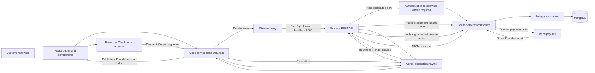
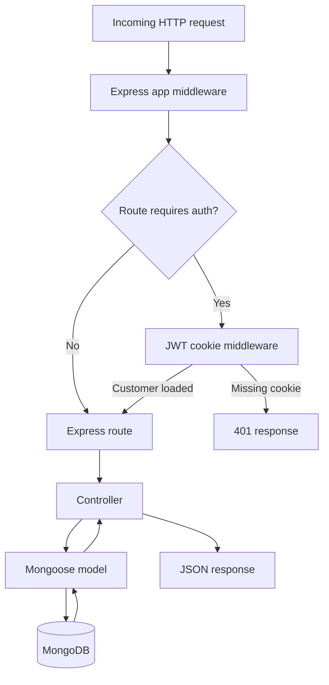
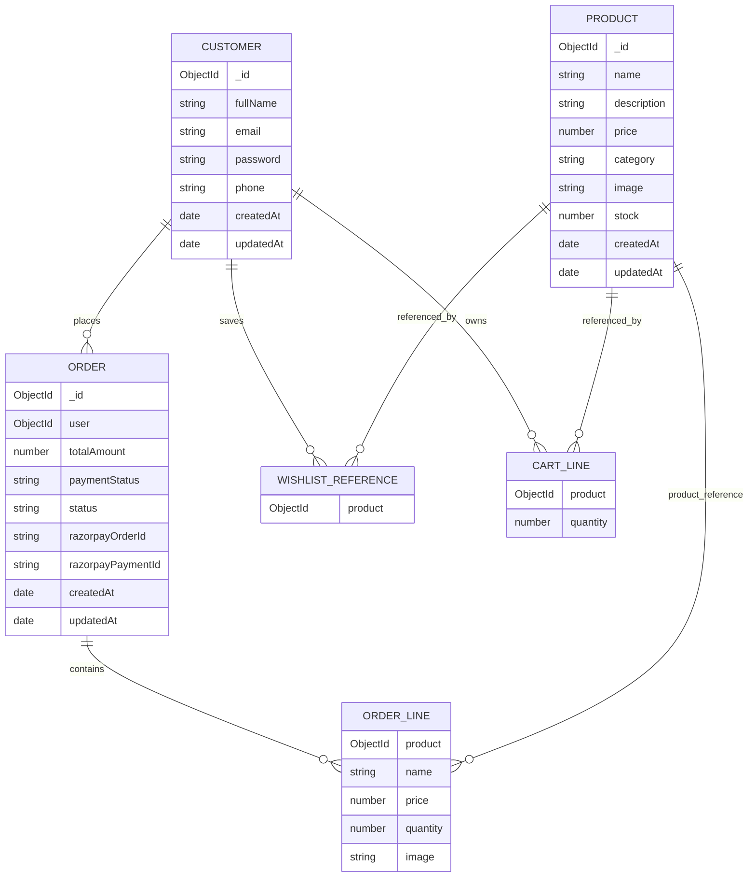
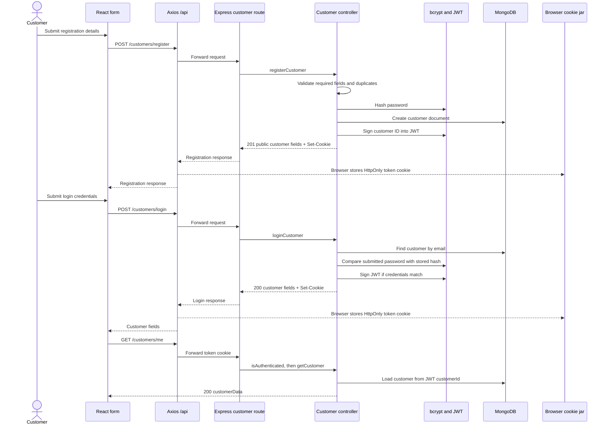
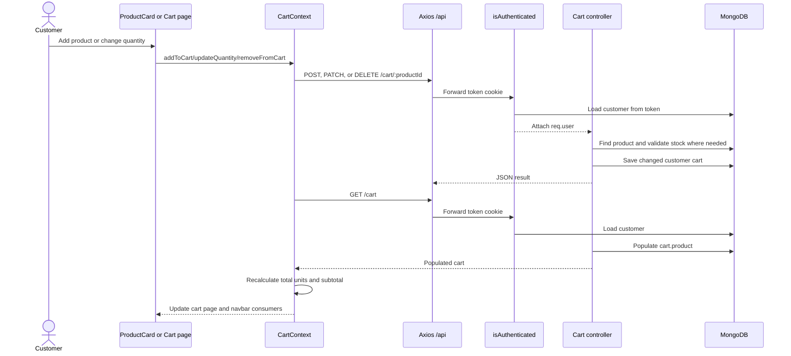
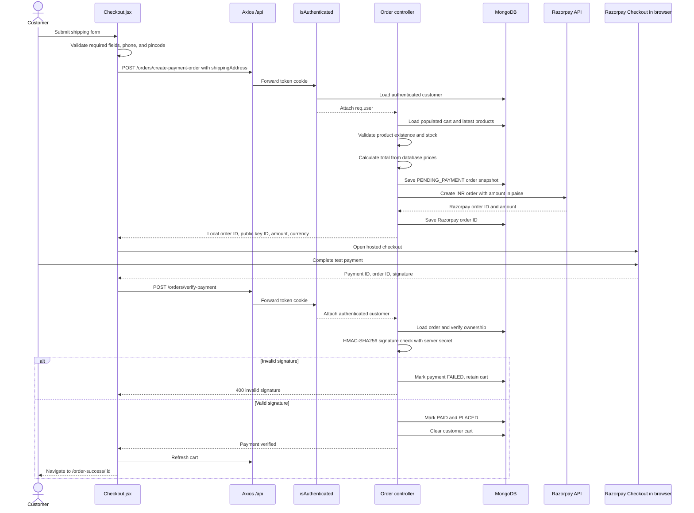
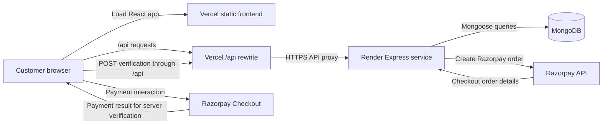

# ShopKart

ShopKart is a full-stack MERN e-commerce lab application. Visitors can browse and search a product catalogue; customers can register, sign in, keep an account-backed wishlist and cart, complete a Razorpay checkout, and review saved orders.

[](https://www.mongodb.com/)
[](https://expressjs.com/)
[](https://react.dev/)
[](https://nodejs.org/)
[](https://vercel.com/)
[](https://render.com/)

| Link | Destination |
|---|---|
| Live application | [shopkart-online.vercel.app](https://shopkart-online.vercel.app/) |
| Backend service | [mern-lab-project-shopkart-x0mo.onrender.com](https://mern-lab-project-shopkart-x0mo.onrender.com/) |
| Backend health check | [/health](https://mern-lab-project-shopkart-x0mo.onrender.com/health) |
| Source repository | [DeeKush/MERN-LAB-PROJECT-SHOPKART-](https://github.com/DeeKush/MERN-LAB-PROJECT-SHOPKART-) |
| Lab problem statements | [Lab-2029-Problem-Statements](https://github.com/mrinal1224/Lab-2029-Problem-Statements) |

Welcome. Explore the live storefront, then use the sections below to understand how the app is organized and run it locally.

## Contents

- [Project overview](#project-overview)
- [Live demo and routes](#live-demo-and-routes)
- [Features](#features)
- [Technology stack](#technology-stack)
- [Architecture](#architecture)
- [Project structure](#project-structure)
- [Data model](#data-model)
- [Application workflows](#application-workflows)
- [API reference](#api-reference)
- [Security and engineering concepts](#security-and-engineering-concepts)
- [Local setup](#local-setup)
- [Deployment](#deployment)
- [Testing and quality checks](#testing-and-quality-checks)
- [Development workflow](#development-workflow)
- [Academic submission](#academic-submission)
- [Learning outcomes](#learning-outcomes)
- [Acknowledgments and references](#acknowledgments-and-references)

## Project overview

ShopKart was built as a sequence of college engineering labs that extend a basic e-commerce application from customer authentication through product discovery, wishlist, cart, checkout, and order history. Its purpose is both practical and educational: it brings together a React interface, an Express REST API, MongoDB persistence, cookie-based JWT authentication, shared cart state, and server-side payment verification.

The application demonstrates how several parts of a shopping journey interact. Product information and customer data are stored in MongoDB; the React client retrieves data through Axios; protected endpoints identify the customer from an HTTP-only cookie; checkout revalidates cart contents and prices on the server; and a local order is updated only after the Razorpay signature is verified.

The project is organized as a series of academic labs and demonstrates how a full-stack shopping flow is assembled from independently organized frontend and backend features.

## Live demo and routes

The [frontend](https://shopkart-online.vercel.app/) is deployed separately from the [Express backend](https://mern-lab-project-shopkart-x0mo.onrender.com/). Browser requests use a same-origin `/api/` path; Vercel rewrites API requests to Render. A separate Vercel fallback serves the React application for client-side routes.

The backend health endpoint is [https://mern-lab-project-shopkart-x0mo.onrender.com/health](https://mern-lab-project-shopkart-x0mo.onrender.com/health). It is implemented to return a JSON status response for basic service checks.

The frontend router in [frontend/vite-project/src/App.jsx](frontend/vite-project/src/App.jsx) defines these routes. Customer-specific API operations validate the session on the backend.

| Route | Purpose |
|---|---|
| `/` | Home storefront |
| `/home` | Home storefront alias |
| `/login` | Customer login form |
| `/register` | Customer registration form |
| `/products` | Catalogue, search, and category filter |
| `/products/:id` | Product detail page |
| `/wishlist` | Account-backed wishlist page |
| `/cart` | Account-backed cart page |
| `/checkout` | Shipping form and Razorpay checkout |
| `/orders` | Current customer's order history |
| `/orders/:id` | One order's details |
| `/order-success/:id` | Order success confirmation display |
| `*` | Not-found page for unmatched routes |

## Features

### Product discovery

- Product listing and individual product detail pages use data fetched from the backend.
- Search matches product names case-insensitively. Category selection filters by exact category. Both may be combined.
- Product cards display image, name, category, price, and stock messaging. The card treats stock of 10 or fewer as low stock.
- The product listing and detail pages include loading and error handling; the listing also displays an empty result state.

### Customer accounts

- Registration collects full name, email, password, and phone. The backend checks required fields, minimum password length, phone length, and duplicate phone/email values.
- Login checks the email and bcrypt password hash, returning a generic invalid-credentials message for a missing customer or incorrect password.
- The backend issues a JWT in an HTTP-only cookie at registration and login. `GET /customers/me` retrieves the current session; logout clears the cookie.
- The browser does not read or store the JWT in JavaScript.

### Wishlist

- Authenticated customers can add a product, view a populated wishlist, and remove a saved product. Wishlist product IDs are stored on the customer document.
- ProductCard offers a browser-local favorite toggle as well as the account-backed wishlist feature.
- The wishlist page distinguishes loading, empty, authentication-required, and error states.

### Shopping cart

- Authenticated customers can add products, change an existing line quantity, and remove a line.
- Adding the same product increments its existing line rather than adding a duplicate. The backend checks current product stock on add and quantity update.
- Cart item quantities and product references persist on the customer record. The populated cart page shows current product information.
- React Context holds shared cart state and derives total units and subtotal. Mutations call the backend and then refresh the populated cart.
- The cart page includes loading, empty, error, and authentication-required states, quantity controls, and an order summary.

### Checkout, payments, and orders

- Checkout collects a shipping address and validates required values, an India-format 10-digit phone number, and a six-digit pincode in both client and server code.
- The server reads the authenticated customer's cart, checks products and stock again, and recalculates the total from current database prices.
- The backend stores a local pending order with purchase-time item and address snapshots, then creates a Razorpay order with an INR amount in paise.
- The browser opens Razorpay Checkout using the public key ID. The key secret stays on the backend.
- The backend verifies the payment signature with HMAC-SHA256. A valid signature marks the order `PAID` and `PLACED` and clears the customer's cart.
- Customers can view their order history and an individual order. The API verifies order ownership.
- If the Razorpay failure event fires, checkout displays a failure message and keeps the cart available.

### Interface and usability

- Shared navigation links the storefront pages and provides account/cart controls. The home page also includes a newsletter form and floating chat control.
- Product cards are reused across the home and catalogue pages.
- Category selection is reflected in the product listing URL, allowing the filtered URL to be shared.
- The layout includes responsive CSS breakpoints.

## Technology stack

| Layer | Technology | Purpose |
|---|---|---|
| Database | MongoDB | Persists customers, products, and orders. |
| ODM | Mongoose | Defines document schemas, validation, references, and queries. |
| Backend runtime | Node.js | Runs the server-side JavaScript application. |
| HTTP API | Express 5 | Mounts REST endpoints and middleware. |
| Frontend | React 19 | Renders the single-page storefront and interaction state. |
| Frontend build/dev server | Vite | Serves development frontend and builds production assets. |
| Client routing | React Router | Maps URL paths to React page components. |
| HTTP client | Axios | Calls backend endpoints through the shared API service. |
| Styling | Tailwind CSS 4 and application CSS | Tailwind is wired through the Vite plugin; `App.css` and `index.css` provide application styles. |
| Password hashing | bcrypt | Hashes customer passwords before persistence and checks passwords at login. |
| Authentication | jsonwebtoken | Signs and verifies customer session tokens. |
| Cookie parsing | cookie-parser | Exposes request cookies to Express middleware. |
| Cross-origin policy | cors | Allows configured browser origins and credentials. |
| Payments | Razorpay Node SDK | Creates Razorpay payment orders from the backend. |
| Frontend hosting | Vercel | Builds the Vite app, proxies `/api/*`, and serves the SPA fallback. |
| Backend hosting | Render | Runs the Express API using its assigned `PORT`. |

## Architecture

The browser renders React pages and calls the shared Axios service. In development, Vite proxies `/api` to the local backend and removes that prefix. In production, Vercel rewrites `/api/:path*` to the Render service and serves `index.html` for other paths. Express routes dispatch requests to controllers, with authentication middleware applied to customer-specific routes. Controllers use Mongoose models to read and write MongoDB. Checkout also calls Razorpay from the backend; the browser receives only the public key ID and checkout information.

### System diagram



### Backend request flow



### Component responsibilities

| Component | Responsibility |
|---|---|
| React pages/components | Present storefront and forms, collect user input, show request states. |
| `src/services/api.js` | Central Axios instance and API wrapper functions. |
| Vite proxy | Development-only `/api` forwarding to local Express. |
| Vercel rewrites | Production API forwarding and React SPA fallback. |
| Express routes | Bind HTTP methods and paths to handlers and auth middleware. |
| Authentication middleware | Verify the session token and attach the customer to `req.user`. |
| Controllers | Validate input, enforce application rules, call models, return JSON. |
| Mongoose models | Define MongoDB document shapes, constraints, and references. |
| MongoDB | Persist customer, product, and order documents. |
| Razorpay | Create external payment orders and provide hosted checkout. |

## Project structure

The repository contains two npm package roots. Run backend commands from `backend/` and frontend commands from `frontend/vite-project/`.

```text
.
├── backend/
│   ├── config/
│   │   └── razorpay.js             # Conditional Razorpay SDK client
│   ├── controllers/
│   │   ├── cart.controller.js      # Cart operations and stock checks
│   │   ├── customer.controller.js  # Registration, login, profile, logout
│   │   ├── order.controller.js     # Checkout, signature verification, orders
│   │   ├── product.controller.js   # Product create/list/detail
│   │   └── wishlist.controller.js  # Account wishlist operations
│   ├── middlewares/
│   │   └── authMiddleware.js       # JWT cookie authentication
│   ├── models/
│   │   ├── customer.model.js       # Customer, wishlist, cart
│   │   ├── order.model.js          # Order snapshots and payment state
│   │   └── product.model.js        # Catalogue product
│   ├── routes/
│   │   ├── cart.routes.js
│   │   ├── customer.routes.js
│   │   ├── order.routes.js
│   │   ├── product.routes.js
│   │   └── wishlist.routes.js
│   ├── utils/
│   │   └── generateToken.js        # Ten-day JWT helper
│   ├── .env.example                # Placeholder environment variables
│   ├── index.js                    # Express entry point, DB connection, port
│   ├── package.json
│   └── package-lock.json
├── frontend/
│   └── vite-project/
│       ├── public/                 # Public static assets
│       ├── src/
│       │   ├── assets/             # Source assets
│       │   ├── components/
│       │   │   ├── FloatingChat.jsx
│       │   │   ├── Footer.jsx
│       │   │   ├── Navbar.jsx
│       │   │   ├── ProductCard.jsx
│       │   │   └── SearchBar.jsx
│       │   ├── context/            # Shared CartContext
│       │   │   └── CartContext.jsx
│       │   ├── pages/
│       │   │   ├── Cart.jsx
│       │   │   ├── Checkout.jsx
│       │   │   ├── Home.jsx
│       │   │   ├── Login.jsx
│       │   │   ├── NotFound.jsx
│       │   │   ├── OrderDetails.jsx
│       │   │   ├── OrderSuccess.jsx
│       │   │   ├── Orders.jsx
│       │   │   ├── ProductDetails.jsx
│       │   │   ├── Products.jsx
│       │   │   ├── Register.jsx
│       │   │   └── Wishlist.jsx
│       │   ├── services/
│       │   │   └── api.js          # Axios instance and endpoint helpers
│       │   ├── App.css
│       │   ├── App.jsx             # React route table
│       │   ├── index.css
│       │   └── main.jsx            # React mount point
│       ├── index.html
│       ├── package.json
│       ├── package-lock.json
│       ├── vercel.json             # API rewrite and SPA fallback
│       └── vite.config.js          # React/Tailwind plugins and dev proxy
├── .gitignore
├── DEPLOYMENT_GUIDE.md
├── LAB6_COMPLETE_GUIDE.md
├── Lab-3-Viva-Prep.md
├── Lab-4-Viva-Prep.md
├── Lab-5-Viva-Prep.md
├── PROJECT_EXPLAINED.md
├── RAZORPAY_TEST_KEY_GUIDE.md
├── VIVA_QUESTIONS.md
└── README.md
```

The root Markdown guides are reference material, not runtime code.

## Data model

MongoDB is accessed through three Mongoose models. The customer schema embeds wishlist IDs and cart lines. Orders reference the owning customer and products, and also copy purchase-time product fields into each order line.

| Entity | Fields and constraints | Relationships and use |
|---|---|---|
| Customer | `fullName` required; `email` required and unique; `password` required; `phone` required; `wishlist` array; `cart` array; timestamps enabled. | Wishlist entries reference `Product`. Each cart line references a `Product` and has `quantity` required, minimum 1, default 1. |
| Product | `name`, `description`, `category`, and `image` required; `price` required with minimum `0.01`; `stock` required with minimum `0`; timestamps enabled. | Referenced from customer wishlist/cart and order lines. |
| Order | `user` required customer reference; `items`; required `shippingAddress` fields; required `totalAmount`; `paymentStatus` enum `PENDING`, `PAID`, or `FAILED`; `status` enum `PENDING_PAYMENT`, `PLACED`, `CONFIRMED`, `SHIPPED`, or `DELIVERED`; Razorpay order/payment IDs; timestamps enabled. | Each line requires a Product reference, name, price, and quantity (minimum 1), and snapshots optional `image`. |



`WISHLIST_REFERENCE` and `CART_LINE` are diagram-only decompositions of the customer document's wishlist array and embedded cart subdocuments. They are not separate MongoDB collections. `populate("wishlist")` resolves wishlist product IDs to Product documents. `populate("cart.product")` resolves the nested product reference on each cart line. Order snapshots preserve item name and price as they were when the order was created, while the product reference remains available for traceability.

## Application workflows

### Registration and login



Registration and login both set a cookie. After registration, the page displays a success message and clears the form. `GET /customers/me` retrieves customer session data for the application.

### Shopping cart



The cart's source of truth is MongoDB. Context provides one shared frontend representation; derived totals are calculated from that representation rather than separately persisted.

### Checkout and Razorpay



The backend verifies the payment signature using `RAZORPAY_KEY_SECRET`, which remains on the server. A valid signature updates the order and clears the cart.

## API reference

All backend paths below are mounted directly by `backend/index.js`, with no duplicated route prefix. In browser requests, the proxy adds `/api` before forwarding and removes it before Express receives the path. For example, browser `GET /api/products?search=phone` is forwarded to Express as `GET /products?search=phone`.

### Health

| Method | Endpoint | Authentication | Description |
|---|---|---|---|
| `GET` | `/health` | No | Returns `{ "status": "ok" }` when the process handles the request. |

### Customer authentication

| Method | Endpoint | Authentication | Description |
|---|---|---|---|
| `POST` | `/customers/register` | No | Creates a customer and sets a session cookie. |
| `POST` | `/customers/login` | No | Verifies credentials and sets a session cookie. |
| `GET` | `/customers/me` | Yes | Returns the authenticated customer as `customerData`. |
| `POST` | `/customers/logout` | Yes | Clears the session cookie. |

### Products

| Method | Endpoint | Authentication | Description |
|---|---|---|---|
| `POST` | `/products` | No | Validates the submitted fields and creates a product. |
| `GET` | `/products` | No | Lists products, optionally filtered by search and category. |
| `GET` | `/products/:id` | No | Returns a product by MongoDB ID. |

Query example: `GET /products?search=phone&category=Electronics`. `search` is a case-insensitive regex match against `name`; `category` is an exact match.

### Wishlist

| Method | Endpoint | Authentication | Description |
|---|---|---|---|
| `GET` | `/wishlist` | Yes | Returns the current customer's populated wishlist. |
| `POST` | `/wishlist/:productId` | Yes | Adds a product reference, rejecting duplicates. |
| `DELETE` | `/wishlist/:productId` | Yes | Removes a product reference. |

### Shopping cart

| Method | Endpoint | Authentication | Description |
|---|---|---|---|
| `GET` | `/cart` | Yes | Returns cart lines with populated product data. |
| `POST` | `/cart/:productId` | Yes | Adds one unit or increments the existing line after stock validation. |
| `PATCH` | `/cart/:productId` | Yes | Sets quantity for an existing line, after quantity and stock validation. |
| `DELETE` | `/cart/:productId` | Yes | Removes a cart line. |

### Checkout and payments

| Method | Endpoint | Authentication | Description |
|---|---|---|---|
| `POST` | `/orders/create-payment-order` | Yes | Validates shipping and cart, stores a pending order, and creates a Razorpay order. |
| `POST` | `/orders/verify-payment` | Yes | Checks ownership and Razorpay HMAC signature; marks payment and order placed on success. |

### Orders

| Method | Endpoint | Authentication | Description |
|---|---|---|---|
| `GET` | `/orders` | Yes | Returns the authenticated customer's orders, newest first. |
| `GET` | `/orders/:id` | Yes | Returns one order only when owned by the authenticated customer. |

Common statuses returned by handlers include `200`, `201`, `400`, `401`, `403`, `404`, `409`, `500`, and `503` when payment credentials are missing.

## Security and engineering concepts

- **bcrypt:** Registration hashes a password with a generated salt and cost factor 10. Login compares the submitted password with the stored hash; it does not decrypt passwords.
- **JWT:** `generateToken.js` signs `{ customerId }` with `JWT_SECRET` and an expiration of 10 days. JWT payloads are signed, not encrypted, and must not contain secrets.
- **HTTP-only cookie:** The `token` cookie is marked `httpOnly`, so browser JavaScript cannot read it. Cookie options also set `sameSite: "lax"`; `secure` is enabled when `NODE_ENV === "production"`.
- **Authentication middleware:** `isAuthenticated` reads `req.cookies.token`, verifies it, loads the customer, attaches the customer document to `req.user`, then calls `next()`. Wishlist, cart, and order routers apply it to their protected endpoints.
- **CORS and credentials:** Express allows localhost frontend origins and the optional `FRONTEND_URL`, with credentials enabled. Axios sets `withCredentials: true`. Production frontend API traffic uses a Vercel rewrite; local traffic uses Vite's proxy.
- **Validation:** Controllers check IDs, required values, password length, quantities, stock, shipping fields, and pincode/phone formats as appropriate. Browser validation improves feedback, but the backend repeats the important checkout checks.
- **ObjectId references and `populate()`:** Customer wishlist and cart store Product ObjectIds rather than copies. `populate()` resolves them when product details are needed. Order items additionally snapshot product name, price, quantity, and image.
- **React Context:** `CartContext` shares one cart state across components that need it, such as product cards, navbar, cart and checkout. Wishlist data is local to the wishlist page, while ProductCard's heart toggle uses separate `localStorage` state.
- **Server state vs. UI state:** MongoDB is the persistent source for cart, wishlist and orders. React loading, error, submitting and display states are temporary UI state. Cart totals are derived from the cart array.
- **Payment verification:** The backend computes HMAC-SHA256 using the saved Razorpay order ID, payment ID, and private key secret. The order status changes after the server verifies the signature.

## Local setup

### Prerequisites

- Node.js and npm. The manifests use modern React/Vite and backend dependencies; no fixed Node version is declared in the repository.
- Network access to a MongoDB instance and a connection string.
- Razorpay Test Mode keys if you want to exercise checkout. The rest of the app can start without Razorpay credentials, but checkout responds with `503`.

### Install and run

From the repository root, use two separate terminals.

Backend:

```powershell
cd backend
npm install
npm run dev
```

Frontend:

```powershell
cd frontend/vite-project
npm install
npm run dev
```

Vite normally prints `http://localhost:5173`. Express uses `process.env.PORT` when present and otherwise listens on `8088`. Vite proxies `/api/*` to `http://localhost:8088`, stripping `/api` before Express handles the route.

### Environment variables

Create `backend/.env` from [backend/.env.example](backend/.env.example). Replace placeholders locally, and do not commit the populated file. Render receives production values through its service environment settings.

| Variable | Purpose | Required for |
|---|---|---|
| `dbURL` | MongoDB connection string used by Mongoose. | Database-backed app behavior. |
| `JWT_SECRET` | Signs and verifies customer JWTs. | Registration, login, and protected APIs. |
| `RAZORPAY_KEY_ID` | Razorpay public checkout key ID. | Payment checkout. |
| `RAZORPAY_KEY_SECRET` | Server-side Razorpay signature verification secret. | Payment checkout and verification. |
| `NODE_ENV` | Enables the cookie `secure` flag when set to `production`. | Set to `production` on Render; `development` locally. |
| `FRONTEND_URL` | Optional frontend origin included in Express CORS allowlist. | Cross-origin browser calls; configure to exact deployed Vercel origin. |
| `PORT` | HTTP port. Uses `8088` if unset. | Render supplies it automatically; optional locally. |

`PORT` is a platform-provided runtime value, not included in `backend/.env.example`. Vercel does not need a `VITE_API_URL` variable because the frontend uses a relative `/api/` base URL.

### Troubleshooting

| Symptom | Checks |
|---|---|
| `npm` cannot find a package file | Run commands from the package root: `backend/` or `frontend/vite-project/`. |
| MongoDB connection error | Check `dbURL`, database user/password encoding, Atlas network access, and Render logs. |
| Protected request returns `401` | Sign in, confirm the `token` cookie exists, and verify `JWT_SECRET` is configured consistently. |
| Browser reports CORS failure | Check Render's `FRONTEND_URL` exactly matches the Vercel origin, without a trailing slash. For production, API browser calls should use the Vercel `/api/` path. |
| API requests use `localhost` in production | Rebuild/deploy the current frontend code and check Vercel's `/api` rewrite destination. |
| Checkout reports Razorpay is unavailable | Configure a matching `RAZORPAY_KEY_ID` and `RAZORPAY_KEY_SECRET` pair on the backend. Keep the secret out of frontend configuration. |
| Render health check returns an error | Check service logs, environment variables, MongoDB connectivity, and whether Render deployed the current `main` revision. The health route is `/health`. |

## Deployment

The deployment configuration is Vercel for the frontend and Render for the Express backend. [frontend/vite-project/vercel.json](frontend/vite-project/vercel.json) targets `https://mern-lab-project-shopkart-x0mo.onrender.com`.

### Vercel frontend

- Project root: `frontend/vite-project`
- Build command: `npm run build`
- Output directory: `dist`
- Rewrites: `/api/:path*` to the Render API, followed by `/(.*)` to `/index.html` for React Router paths.

Keep the API rewrite before the SPA fallback so API requests are sent to the backend rather than receiving the frontend shell. If the Render host changes, update [frontend/vite-project/vercel.json](frontend/vite-project/vercel.json) and redeploy.

### Render backend

- Root directory: `backend`
- Build command: `npm install`
- Start command: `npm start` (`node index.js`)
- Render injects `PORT`; the app falls back to `8088` locally.
- Configure `dbURL`, `JWT_SECRET`, `NODE_ENV=production`, `FRONTEND_URL`, and the matching Razorpay key pair in the Render environment.
- Health check path: `/health`.

### Deployment diagram



### Deployment checklist

- [ ] Backend root, build command, and start command match the values above.
- [ ] MongoDB URL is set privately, and the deployment host can reach the database.
- [ ] `JWT_SECRET` is set and not exposed in frontend variables.
- [ ] `FRONTEND_URL` exactly matches the public Vercel origin.
- [ ] Razorpay Test Mode ID and secret are a matching pair in Render.
- [ ] Vercel rewrite points to the current Render hostname and comes before the SPA fallback.
- [ ] `npm run build` succeeds from `frontend/vite-project`.
- [ ] Check `/health` and review service logs after deployment.
- [ ] End-to-end test covers account session, product requests, cart, checkout verification, and order history.

## Testing and quality checks

The frontend package exposes build and lint scripts. The backend does not have an automated test suite: its `npm test` script is a placeholder that exits with an error.

### Build and static checks

```powershell
cd frontend/vite-project
npm run build
npm run lint
```

A basic backend syntax check can be run from the repository root:

```powershell
node --check backend/index.js
```

This syntax check does not test database access, API behavior, cookies, or Razorpay. Build and lint commands are available for the frontend; endpoint behavior can be checked with the manual checklist below.

### Manual verification checklist

- [ ] Register with valid details and confirm duplicate email/phone errors.
- [ ] Log in, refresh the page, check the session via the navbar, and log out.
- [ ] Browse products, search by name, filter by category, and open a product detail route.
- [ ] Add and remove account wishlist entries.
- [ ] Add the same product to cart twice and verify its quantity increments.
- [ ] Update quantity below, within, and above current stock; remove a cart line.
- [ ] Check derived item count and subtotal.
- [ ] Submit incomplete/invalid shipping values and verify no payment-order request is sent.
- [ ] Use Razorpay Test Mode to exercise signature verification, order status, and cart clearing.
- [ ] Inspect order history/details and confirm another customer's order is rejected.

## Development workflow

1. Explore the relevant route, controller, model, and frontend service before changing a feature.
2. Make a focused branch for a change and keep commits small and descriptive.
3. Run `npm run lint` and `npm run build` from `frontend/vite-project`; use `node --check` for a basic changed backend file syntax check. Exercise affected API flows manually because automated backend tests are not configured.
4. Review `git diff` and `git status` before committing. Do not include `.env` files, credentials, or unrelated generated files.
5. For a pull request, explain the behavior changed and list the checks actually performed.

## Academic submission

The project follows the ShopKart sequence described in the external [lab problem statements repository](https://github.com/mrinal1224/Lab-2029-Problem-Statements):

| Lab | Statement title | Related implementation in this project |
|---|---|---|
| Lab 01 | Engineering Lab 01: ShopKart Customer Authentication Service | Customer model and registration, login, profile, and logout APIs using bcrypt and JWT cookies. |
| Lab 02 | Engineering Lab 02: ShopKart: Login to Home | React registration and login pages, session-aware navigation, and client-side routing. |
| Lab 03 | Engineering Lab 03: ShopKart: Product Catalog & Discovery | Product schema and APIs, search and category filtering, catalogue, and product details. |
| Lab 04 | Engineering Lab 04: ShopKart Wishlist | Customer-specific wishlist references, protected APIs, and wishlist page. |
| Lab 05 | Engineering Lab 05: ShopKart Shopping Cart | Persistent cart lines, stock-aware cart APIs, shared React Context, and derived totals. |
| Lab 06 | Engineering Lab 06: ShopKart Checkout & Orders | Shipping form, server-side cart validation, Razorpay payment verification, order snapshots, and order history. |

Academic details, to be completed by the student:

| Field | Details |
|---|---|
| Student name | [Student name] |
| Student ID | [Student ID] |
| Batch or cohort | [Batch or cohort] |
| Course or lab name | [Course or lab name] |
| Instructor, if required | [Instructor name] |
| Submission date, if required | [Submission date] |

This table maps implemented project functionality to the related lab topics.

## Learning outcomes

This implementation provides examples of:

- Building a React and Express application with separate frontend and backend packages.
- Organizing an API into routes, middleware, controllers, and Mongoose models.
- Designing MongoDB references, populating related documents, and preserving order snapshots.
- Hashing passwords and issuing cookie-based JWT sessions.
- Building user-specific REST resources for wishlist, cart, and orders.
- Sharing cart state with React Context and deriving subtotal/count values from it.
- Revalidating checkout price and stock on the server.
- Creating Razorpay orders and verifying payment signatures server-side.
- Deploying a Vite frontend and Express backend separately with Vercel rewrites and Render environment configuration.

## Acknowledgments and references

Thanks for exploring ShopKart. The project was developed alongside the [ShopKart lab problem statements](https://github.com/mrinal1224/Lab-2029-Problem-Statements). Source code is available at [DeeKush/MERN-LAB-PROJECT-SHOPKART-](https://github.com/DeeKush/MERN-LAB-PROJECT-SHOPKART-).

- [React documentation](https://react.dev/)
- [Node.js documentation](https://nodejs.org/docs/)
- [Express documentation](https://expressjs.com/)
- [MongoDB documentation](https://www.mongodb.com/docs/)
- [Mongoose documentation](https://mongoosejs.com/docs/)
- [Vite documentation](https://vite.dev/guide/)
- [Vercel rewrites documentation](https://vercel.com/docs/rewrites)
- [Render Node.js web services](https://render.com/docs/node-express-app)
- [Razorpay Standard Checkout documentation](https://razorpay.com/docs/payments/payment-gateway/web-integration/standard/)

Thanks for taking the time to explore ShopKart and its implementation.